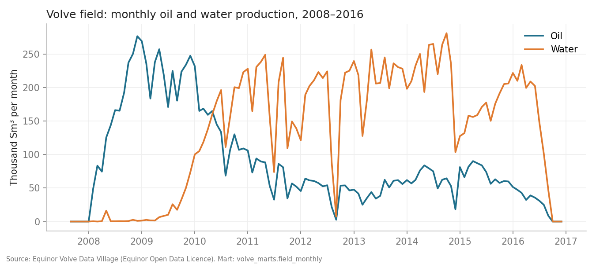
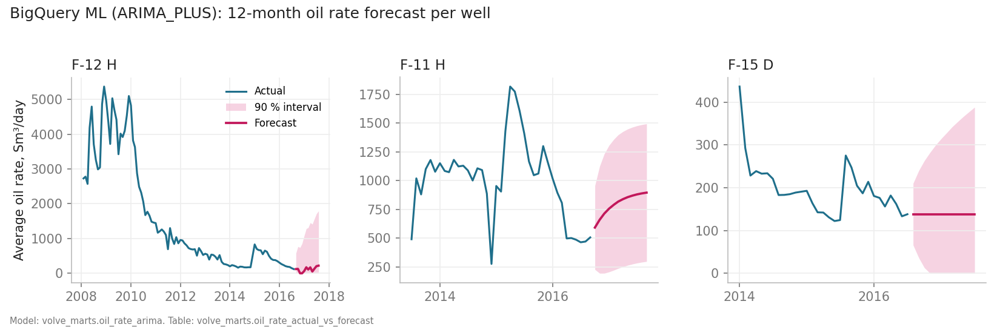

# Volve production pipeline on Google Cloud

An end-to-end data engineering pipeline on **Google Cloud Platform**: real daily
production data from the Volve oil field (Equinor open data, Norwegian North
Sea, 7 wellbores, 2007–2016, 15,634 daily rows) goes from an Excel export into
**BigQuery**. There it is modelled in SQL layers, checked by automated data
quality rules, reconciled against the official monthly report, forecast with
**BigQuery ML**, and shown in a **Looker Studio** dashboard.

```
 Equinor export (.xlsx)
        │  extract.py   pandas: land the sheets as Parquet, BigQuery-safe column names, audit columns
        ▼
 Cloud Storage  gs://<bucket>/landing/volve/ingest_date=YYYY-MM-DD/*.parquet   (optional)
        │  load.py      BigQuery load job, WRITE_TRUNCATE (idempotent re-runs)
        ▼
 BigQuery  volve_raw       raw tables, exactly as received
        │  sql/staging  typing, null rules, KPIs, partitioned by month + clustered by well
        ▼
 BigQuery  volve_staging   daily_production, monthly_production
        │  sql/marts    well_summary, well_monthly, field_monthly, daily_vs_monthly_reconciliation
        ▼
 BigQuery  volve_marts  ──► sql/quality  8 checks (error = stop, warn = log) → data_quality_log
        │                ──► sql/ml       ARIMA_PLUS per well → 12-month oil rate forecast
        ▼
 Looker Studio dashboard   (see docs/dashboard.md)

 Orchestration: Cloud Run job (Dockerfile) triggered by Cloud Scheduler (see docs/deploy.md)
```

## What it does

| Step | Where | What |
|---|---|---|
| Extract | `pipeline/extract.py` | Reads both sheets (daily and official monthly), keeps values as received, writes Parquet. |
| Land | Cloud Storage | Date-partitioned landing folder, so every load can be traced and replayed. |
| Load | `pipeline/load.py` | Creates the 3 datasets if missing and loads `volve_raw`. Re-runs replace, never duplicate. |
| Staging | `sql/staging/` | Renames NPD codes, casts types, counts missing volumes as 0, treats 0 bar as "no reading". Computes water cut, GOR, uptime, downtime days and cumulative volumes with window functions. The table is **partitioned by month and clustered by well** to cut query cost. |
| Marts | `sql/marts/` | Well lifetime KPIs, well × month and field × month tables, plus a **reconciliation** of the daily data against the official monthly report. |
| Quality | `sql/quality/checks.sql` | Checks unique well-day, null keys, raw vs staging row count, hours 0–25, water cut 0–100, negative volumes, oil without hours, and reconciliation. Results are appended to `volve_marts.data_quality_log`, and any `error` check stops the run. |
| ML | `sql/ml/` | BigQuery ML `ARIMA_PLUS`: one model per producing well, 12-month oil rate forecast with a 90 % interval. |





Charts are rendered from the BigQuery marts with `python make_charts.py`.

## Results (first run)

- 15,634 daily rows in, 15,634 rows in staging; no duplicate well-days and no null keys.
- **526 / 526 well-months reconcile** with the official monthly report (0 Sm3 difference).
- Same lifetime totals as the earlier pandas analysis, to the cent, for all 6 producers. For example, F-12 H: 4,579,609.55 Sm3 of oil at 59.4 % average water cut.
- Warnings logged, not hidden: 4 days with negative water volumes as reported, and 1 day with oil but 0 on-stream hours.
- 25-hour days are valid: they are the autumn clock change, so the hours rule allows 0 to 25.

## Run it

```bash
python3 -m venv .venv && .venv/bin/pip install -r requirements.txt

# 1. Free dry run on the laptop (DuckDB runs the same BigQuery SQL, translated by sqlglot)
.venv/bin/python run_pipeline.py --local

# 2. On Google Cloud
gcloud auth application-default login
cp .env.example .env          # set GCP_PROJECT (and GCS_BUCKET if billing is on)
.venv/bin/python run_pipeline.py
```

The free **BigQuery sandbox** (no credit card) runs everything except the Cloud
Storage landing zone and the Cloud Run deployment. Leave `GCS_BUCKET` empty
there and BigQuery loads the files directly. Also set `PARTITION_TABLES=false`
there: the sandbox expires partitions older than 60 days, and on the first run
this silently emptied the 2008–2016 staging table. Clustering still applies,
and partitioning comes back on a billed project.

## Design choices

- **ELT, with the business rules in SQL.** Extraction never changes values. Every rule is a reviewable SQL file under version control.
- **Idempotent.** `WRITE_TRUNCATE` loads and `CREATE OR REPLACE` models mean a re-run gives the same result, never duplicates.
- **Cost-aware.** Monthly partitions and well clustering on the main table, and the marts are small and pre-aggregated for the dashboard.
- **Trust the numbers.** The daily data is reconciled against the official monthly report, quality results are stored over time, and blocking checks stop bad data before it reaches the dashboard.
- **Testable offline.** The same SQL runs on DuckDB for a free local test before it touches the cloud.

## Limitations

- **ARIMA is not a decline model.** ARIMA_PLUS is a statistical time-series model, so for wells near the end of life it can forecast a rise (F-11 H) or a flat line (F-15 D). In practice an engineer would use Arps decline curves for production forecasting. The BigQuery ML step shows the in-warehouse ML workflow, not a reservoir forecast.
- The field shut down in September 2016, so the forecast period never happened. It cannot be checked against reality, only back-tested on held-out months (a possible next step).

## Data source and licence

The data is the daily production file (`Volve production data.xlsx`) from the
**Volve Data Village**. Equinor ASA and the former Volve licence partners
(ExxonMobil Exploration & Production Norway AS and Bayerngas Norge AS)
released it publicly in June 2018: all subsurface and operating data from
Volve, a North Sea oil field in block 15/9 that produced from 2008 until it was
shut down in September 2016.

- Official page: https://www.equinor.com/energy/volve-data-sharing (downloads are now distributed through the Databricks Marketplace, free Equinor sign-up)
- Release announcement: https://www.equinor.com/news/archive/14jun2018-disclosing-volve-data
- Licence: [Equinor Open Data Licence – Volve](https://www.equinor.com/content/dam/statoil/documents/what-we-do/Equinor-HRS-Terms-and-conditions-for-licence-to-data-Volve.pdf). It is based on CC BY 4.0: commercial and public use is allowed, with attribution, and the data may not be sold.

© Equinor and the former Volve licence partners. The data is unmodified apart
from format conversion. The derived tables, charts and code are my own and
are not endorsed by Equinor.
